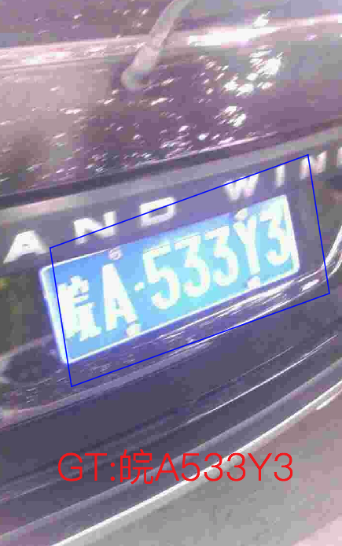
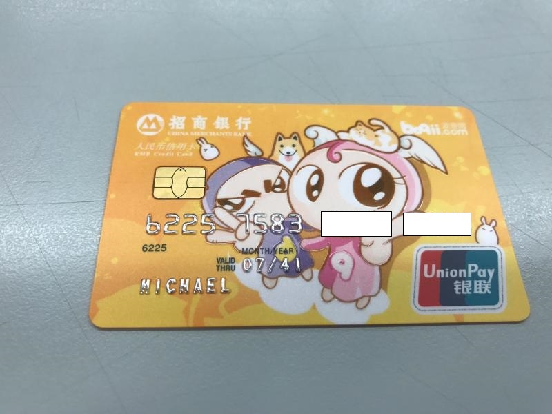
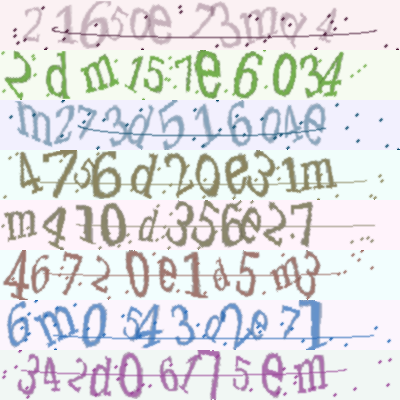
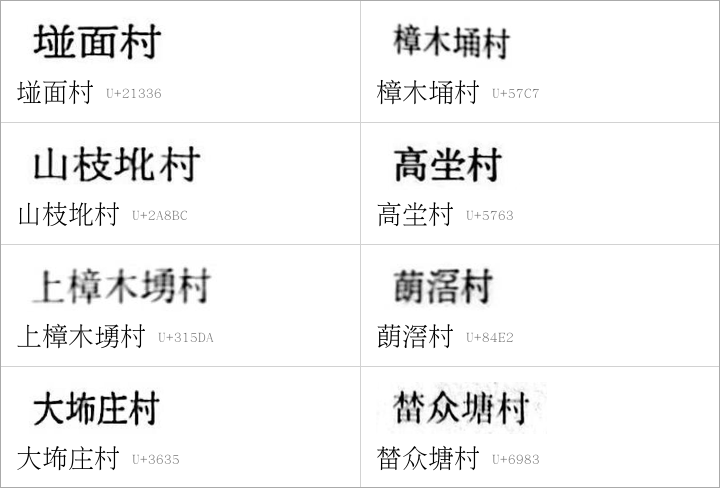

# Vertical multi-language OCR dataset

Here we have sorted out the commonly used vertical multi-language OCR dataset datasets, which are being updated continuously. We welcome you to contribute datasets ～

- [Chinese urban license plate dataset](#chinese-urban-license-plate-dataset)
- [Bank credit card dataset](#bank-credit-card-dataset)
- [Captcha dataset-Captcha](#captcha-dataset-captcha)
- [multi-language dataset](#multi-language-datasetmulti-lingual-scene-text-detection-and-recognition)
- [Guangdong place-name rare character dataset-GD-RareName](#guangdong-place-name-rare-character-dataset-gd-rarename)

## Chinese urban license plate dataset

- **Data source**：[CCPD](https://github.com/detectRecog/CCPD)

- **Data introduction**: It contains more than 250000 vehicle license plate images and vehicle license plate detection and recognition information labeling. It contains the following license plate image information in different scenes.

    - CCPD-Base: General license plate picture
    - CCPD-DB: The brightness of license plate area is bright, dark or uneven
    - CCPD-FN: The license plate is farther or closer to the camera location
    - CCPD-Rotate: License plate includes rotation (horizontal 20\~50 degrees, vertical-10\~10 degrees)
    - CCPD-Tilt: License plate includes rotation (horizontal 15\~45 degrees, vertical 15\~45 degrees)
    - CCPD-Blur: The license plate contains blurring due to camera lens jitter
    - CCPD-Weather: The license plate is photographed on rainy, snowy or foggy days
    - CCPD-Challenge: So far, some of the most challenging images in license plate detection and recognition tasks
    - CCPD-NP: Pictures of new cars without license plates.

      

- **Download address**
    - Baidu cloud download address (extracted code is hm0U): [https://pan.baidu.com/s/1i5AOjAbtkwb17Zy-NQGqkw](https://pan.baidu.com/s/1i5AOjAbtkwb17Zy-NQGqkw)
    - Google drive download address:[https://drive.google.com/file/d/1rdEsCUcIUaYOVRkx5IMTRNA7PcGMmSgc/view](https://drive.google.com/file/d/1rdEsCUcIUaYOVRkx5IMTRNA7PcGMmSgc/view)

## Bank credit card dataset

- **Data source**: [source](https://www.heywhale.com/mw/dataset/5954cf1372ead054a5e25870)

- **Data introduction**: There are three types of training data
    - 1.Sample card data of China Merchants Bank: including card image data and annotation data, a total of 618 pictures
    - 2.Single character data: including pictures and annotation data, 37 pictures in total.
    - 3.There are only other bank cards, no more detailed information, a total of 50 pictures.

    - The demo image is shown as follows. The annotation information is stored in excel, and the demo image below is marked as
        - Top 8 card number: 62257583
        - Card type: card of our bank
        - End of validity: 07/41
        - Chinese phonetic alphabet of card users: MICHAEL

          

- **Download address**: [cmb2017-2.zip](https://cdn.kesci.com/cmb2017-2.zip)

## Captcha dataset-Captcha

- **Data source**: [captcha](https://github.com/lepture/captcha)
- **Data introduction**: This is a toolkit for data synthesis. You can output captcha images according to the input text. Use the toolkit to generate several demo images as follows.

    

- **Download address**: The dataset is generated and has no download address.

## multi-language dataset(Multi-lingual scene text detection and recognition)

- **Data source**: [source](https://rrc.cvc.uab.es/?ch=15&com=downloads)
- **Data introduction**: Multi language detection dataset MLT contains both language recognition and detection tasks.
    - In the detection task, the training set contains 10000 images in 10 languages, and each language contains 1000 training images. The test set contains 10000 images.
    - In the recognition task, the training set contains 111998 samples.
- **Download address**: The training set is large and can be downloaded in two parts. It can only be downloaded after registering on the website:
[source](https://rrc.cvc.uab.es/?ch=15&com=downloads)

## Guangdong place-name rare character dataset-GD-RareName

- **Data source**: [Hugging Face](https://huggingface.co/datasets/Sandman4058/GD-RareName)
- **Data introduction**: Village-name text line images cropped from the table-of-contents pages of *Quan Yue Cun Qing*, a survey of Guangdong's natural villages. It targets rare characters in Guangdong place names and was compiled by Eric Tseng.
    - 122,420 real line images, split by volume into 60,501 train, 29,351 val and 32,568 test lines; lines from one volume appear in only one split. 3,849 lines were checked by hand. The other labels come from matching against a place-name database, agreement between two recognizers, or rules, and were not checked by hand.
    - 72,739 synthetic line images of Guangdong place names containing the target characters, rendered with open-source fonts, for training only.
    - 261 target characters: 184 are not in the PP-OCRv5/PP-OCRv6 recognition dictionaries (e.g. 𡌶, 𪢼, 𱗚, 㘵), and 77 are in the dictionaries but are often recognized as a similar-looking character (e.g. 埇→埔, 坣→坐, 塱→望, 榃→替). `charlist.csv` gives the code point, Unicode block and dictionary coverage of each character.
    - A benchmark of 5,317 lines whose labels contain target characters (2,399 of them checked by hand), plus 2,000 random ordinary lines each from val and test for comparison, with an evaluation script. 3,021 of the 5,317 lines come from training volumes; to evaluate a model trained on this dataset, use only the 1,226 lines from val volumes and the 1,070 lines from test volumes, which is what the evaluation script does by default.
    - On the 1,070 benchmark lines from test volumes, the PP-OCRv6 medium recognition model reads 34.2% of lines exactly right; after extending its dictionary and fine-tuning on the training part of this dataset, 98.9%.
    - Images and labels are stored as parquet, with the image, text label, label source, volume and page of each line. The included `to_paddleocr.py` exports them as image files and label files for PaddleOCR training.

    The image below shows hand-checked lines from the test and val splits, with their labels underneath:

    

- **Download address**: [Hugging Face](https://huggingface.co/datasets/Sandman4058/GD-RareName) (license: CC BY-NC 4.0)
